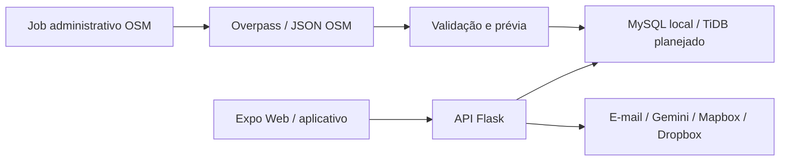

# Litro de Ouro — relatório completo e passagem para o Codex local

**Atualizado em:** 13/11/2026, referência de horário America/Fortaleza.  
**Projeto local informado:** `C:\litro_de_ouro`.  
**Destinatários:** responsável pelo projeto, parceiro de grupo, Gemini e Codex executado na máquina do responsável.  
**Contato público informado:** litrodeourooficial@gmail.com.

## 1. Como utilizar este documento

Este relatório reúne decisões, evolução, arquitetura, evidências e pendências da conversa. É um contexto de continuidade, não uma comprovação de que todo código entregue já está instalado. Parte das entregas foi preparada em cópias isoladas e copiada manualmente pelo responsável. O Codex local deve confrontar este documento com os arquivos e a versão realmente executados no Windows antes de editar.

Os caminhos de código são relativos à raiz do projeto. O documento é autossuficiente: não depende de diretórios internos do ambiente remoto do chat. Códigos mencionados podem estar ausentes do checkout local; nesse caso, registrar a diferença e implementar a integração necessária, sem presumir que uma alteração histórica precisa ser reaplicada inteira.

**Primeira orientação ao Codex local:** leia este relatório e os `AGENTS.md` aplicáveis; examine o estado do repositório, os arquivos Compose e as rotas reais; verifique a duplicação da porta do backend e resolva-a caso ainda exista; depois apresente o diagnóstico das diferenças entre o disco e este relatório e avance pelos blocos pendentes. Preserve alterações do responsável. Não publique nem implante serviços sem nova instrução expressa.

Neste documento, **confirmado pelo responsável** significa evidência enviada do seu ambiente; **preparado/testado em laboratório** significa implementação isolada com os limites descritos; **pendente** significa ausência de confirmação, integração incompleta ou decisão ainda aberta. Um teste com API/GPS simulados não comprova operação em aparelho físico ou provedor real.

## 2. Objetivo e arquitetura

O aplicativo ajuda usuários a localizar postos, comparar preços por combustível e contribuir com informações, inicialmente em João Pessoa/PB. O escopo inclui Mapa, Feed, filtros, cadastro de preços, autoria/data/hora, favoritos, avisos, atividade pessoal, Karma, ranking e assistência por IA.

| Camada | Base conhecida | Papel |
| --- | --- | --- |
| Frontend | Expo, React Native, TypeScript e React Navigation | Interface web e nativa; navegação, sessão, filtros e permissões |
| Mapa | Leaflet; iframe na web e WebView no nativo | Marcadores, segmentos de combustível e interação geográfica |
| Backend | Python, Flask, PyMySQL e Gunicorn | Autenticação, regras, consultas, gravações e integrações |
| Banco de desenvolvimento | MySQL 8.4.13 no Docker | Fonte local dos usuários, catálogo, preços e participação |
| Catálogo geográfico | OpenStreetMap/Overpass | Dados de estabelecimentos; não fornece os preços contribuídos no aplicativo |
| Banco online planejado | TiDB | Persistência online, ainda dependente de configuração/homologação |
| Publicação planejada | Vercel para o frontend web; Render para a API com Docker | Serviços distintos; estado remoto não foi comprovado |
| Integrações | Gemini, Mapbox, Dropbox e e-mail via Google Apps Script | Recursos específicos que exigem validação real |



A consulta normal ao mapa lê o banco da aplicação. Importação OSM e processamento periódico da fila são rotinas separadas. Docker empacota processos; não substitui banco, hospedagem ou domínio. Publicar Expo Web na Vercel também não publica automaticamente aplicativos nas lojas.

## 3. Estado executivo na última conversa

| Área | Evidência disponível | O que falta conferir |
| --- | --- | --- |
| API e banco locais | Verificador Docker já retornou sucesso, TLS, login e perfil | Inicialização atual bloqueada pela configuração de portas descrita abaixo |
| Sessão/GPS/mobile | Responsável confirmou persistência, posição e usabilidade em versão anterior | Revalidar na versão atual e após mudança de endereço da API |
| Catálogo OSM | Última contagem global informada: 59 postos, sendo 55 OSM e quatro fictícios | Contagem atual e cobertura/ofertas reais; não presumir cobertura completa |
| Preços | API recente mostrou quatro produtos com preço no Maxi Posto | Homologação completa do cadastro, distância de produção e duas contas |
| Conta e favoritos | Nome e ações de favoritos confirmados por relato após correção das rotas | E-mail real, senha, exclusão e persistência em todos os cenários |
| Preferências/central | Responsável informou funcionamento após revisão da confirmação | Entrega de avisos com novos preços reais, fila e transporte push |
| Karma/ranking | Backend e telas preparados; testes isolados | Aplicação atual, saldo/eventos e ranking com contribuições reais |
| Assistente por texto/voz | Busca e aplicação de filtros preparados e testados | Modelo/chave/quota reais e microfone/dispositivo reais |
| Busca por nome no Feed | Código e integração preparados | Confirmar os arquivos aplicados no Windows |
| Confirmação de oferta | Causa das bordas cinza comprovada; correção preparada e testada | Aplicar os fontes e confirmar as ofertas verificadas no aplicativo |
| Votos | Rota e atualização de pontuação existem no backend | Botões, dados de confiança na API/telas e política de validação |
| Online/OSM automático | Plano separado documentado | TiDB, Render/Vercel, provedores, executor e agendamento reais |
| Privacidade | Contato e controles técnicos parciais | Responsável completo, aviso definitivo, retenção e operação dos direitos |

Uma versão do ambiente de desenvolvimento foi publicada em determinado momento da conversa. Isso não comprova deploy do aplicativo no Render/Vercel nem autorização para repetir publicações. As confirmações de funcionamento referem-se à versão e ao fluxo que o responsável efetivamente testou.

## 4. Evolução do trabalho

1. **Fundação de autenticação e GPS:** separação entre entrada e área principal, sessão persistente, visitante, validação de token no perfil e tratamento honesto da localização. Foram corrigidos caminhos incompletos e módulos/imports ausentes.
2. **Infraestrutura de banco:** distinção entre configurações externas antigas e o MySQL local em Docker; TLS, certificados, volume persistente, permissões, scripts de inicialização/verificação e migrações versionadas. Um erro ao abrir a tabela administrativa `user` no DBeaver não comprovava falha na tabela de usuários do aplicativo.
3. **Design e navegação:** referências visuais e blocos responsivos para Mapa, Feed, autenticação e conta. O histórico registrou 44 referências, incluindo estados/variações; isso não significa 44 funcionalidades implementadas. Alguns arquivos recebidos ainda tinham o visual anterior.
4. **Mapa, filtros e dados:** contrato explícito de seis combustíveis, oferta desconhecida preservada, uma referência de preço e barrinhas por interseção. Foram ajustados tipos de mapa/bridge e substituída a utilização de uma tela legada com mocks.
5. **OSM real:** testes da fonte tiveram 403, 406, 502 e timeouts, inclusive mensagem de capacidade ocupada. Uma prévia de recorte teve 12 elementos: seis novos, dois ambíguos e quatro ignorados. A carga municipal via JSON permitiu importar 55 postos e chegar à contagem histórica de 59.
6. **Mobile:** o acesso pelo Expo Go foi estabelecido pelo QR Code/LAN. A tentativa de abrir Android por ADB exigia SDK/emulador e era outro caminho. Houve correções de alcance da API, portas e endereço do notebook. Sessão, GPS e cores de combustível foram aprovados por relato em versão anterior.
7. **Conta e participação:** foram preparados nome/e-mail/exclusão, favoritos, notificações, preferências, histórico e ranking. Rotas novas não funcionavam porque blueprints estavam ausentes do `app/__init__.py` executado. Após salvar o arquivo correto e reconstruir o backend, o responsável confirmou nome/favoritos.
8. **Consolidação de 12/11:** ZIPs de infraestrutura foram revisados; houve arquivos de raiz ausentes e um `docker.zip` vazio. Referências anteriores completaram o laboratório, sem provar os arquivos locais ausentes. Foram preparados 52 arquivos e refatorado o migrador em módulos menores.
9. **Incrementos de 13/11:** confirmação visível de preferências após PUT/GET; telas de Karma/ranking; busca assistida; busca por nome no Feed; remoção do mapa legado com posição fictícia; configuração separada do raio de testes; confirmação explícita de oferta.
10. **Último bloqueio operacional:** o IP do notebook mudou de `192.168.0.2` para `192.168.1.9`. O Compose efetivo mostrou duas publicações de 5001, incluindo o IP antigo. A correção foi orientada; ainda não chegou nova evidência de inicialização saudável após essa correção.

## 5. Organização do código a conferir localmente

```text
litro_de_ouro/
  compose.yaml
  docker/
    local/.env                         # privado; não copiar para relatórios
    compose.testes-precos.yaml          # override local opcional
  back_end/
    app/__init__.py                    # factory e registro dos blueprints
    app/rotas/                         # auth, conta, postos, precos, participação, IA...
    app/utils/geofence.py              # validação de proximidade
    services/catalogo_postos.py        # consulta em lote e contrato de ofertas
    services/atividade_alertas.py      # eventos, Karma e avisos
    services/comandos_ia.py            # interpretação limitada aos filtros
    services/migrations.py            # migrador e módulos auxiliares
    migrations/                       # SQL versionado
    scripts/                          # migrar, importar OSM e processar alertas
    docker/verificar_local.py
  front_end/
    src/contexts/                     # autenticação, filtros, favoritos e tema
    src/routes/                       # AuthStack, abas e pilha da conta
    src/components/mapa/              # Leaflet, HTML, tipos e bridge
    src/services/                     # API, sessão, catálogo, ofertas e assistente
    src/screens/ConsultaPostos/        # Mapa/Feed; detalhes e layout separados
    src/screens/AdicionarPreco/
    src/screens/Assistente/
    src/screens/                      # entrada, conta, favoritos, ranking, avisos...
    tests/
```

Arquivos recentes para buscar especificamente: `services/comandos_ia.py` e `app/rotas/assistente.py` no backend; `services/assistente.ts`, `voz.ts`, `voz.web.ts`, `buscaPostosNome.ts`, `ofertas.ts`, `components/lista-postos-consulta.tsx`, `components/confirmar-oferta.tsx` e `screens/ConsultaPostos/{index,detalhes,layout}.tsx` no frontend; `app/rotas/ofertas.py` no backend.

O arquivo legado `front_end/src/screens/Mapa/index.tsx` deve apenas reexportar `../ConsultaPostos` se essa correção estiver aplicada. Ele continha `MOCK_POSTOS`, `MOCK_USUARIO`, imports e estilos antigos. A rota principal já utilizava `ConsultaPostos`; evitar construir uma segunda consulta/API/GPS nesse arquivo.

### Rotas essenciais para conferir na factory e no processo executado

| Método e caminho | Função / ponto de atenção |
| --- | --- |
| `POST /auth/login`; `GET /auth/perfil` | Login e validação de sessão; preservar as demais rotas de cadastro/código/recuperação |
| `GET /postos` | Catálogo público, múltiplos combustíveis, referência, marca e ordenação |
| `POST /precos` | Registro autenticado com GPS e validações; conferir também o alias legado por posto |
| `POST /precos/<registo_id>/votar` | Voto no registro específico; integração visual ainda pendente |
| `POST /postos/<posto_id>/ofertas/<codigo>/confirmar` | Confirmação explícita de disponibilidade; blueprint novo sem prefixo adicional |
| `PATCH /conta/nome`; `DELETE /conta` | Nome e exclusão da conta autenticada |
| `POST /conta/email/solicitar`; `POST /conta/email/confirmar` | Troca verificada de endereço |
| `GET /favoritos`; `PUT`/`DELETE /favoritos/postos/<posto_id>` | Consulta e alteração de favoritos por conta |
| `PUT /favoritos/preferencias` | Combustíveis favoritos e preferências dos avisos |
| `GET /notificacoes`; `PUT /notificacoes/<id>/lida` | Central e leitura confirmada |
| `GET /atividade/meus-registos`; `GET /atividade/karma`; `GET /ranking` | Contribuições, histórico/saldo e ranking; conferir acesso de cada rota |
| `POST /ia/consultar`; `POST /ia/ler-totem` | Busca assistida e leitura de imagem; provedores reais ainda exigem homologação |

Os nomes entre `<...>` indicam parâmetros conceituais; a CLI Flask pode mostrar conversores como `<int:posto_id>`. A existência de uma rota não comprova seus fluxos, autorização ou integração com as telas. Rotas de custo presentes em fontes antigos não devem ser consideradas ativas sem aparecer na factory atual.

## 6. Diretrizes permanentes de desenvolvimento

- Trabalhar sobre a versão efetiva do disco. Ler instruções locais aplicáveis, examinar `git status`/diff quando houver Git e preservar alterações do responsável. Não executar reset/limpeza para obter uma árvore aparentemente limpa.
- Entregar código utilizável e explicar arquivos, integração, testes e limites. Preferência do responsável: códigos no chat ou arquivos individuais; **não enviar ZIPs**. Este relatório é documentação, não um pacote de código.
- Preferir arquivos de código com até **500 linhas**, com flexibilidade justificada. Separar responsabilidades; não minificar nem remover legibilidade para cumprir contagem. Arquivos legados maiores ainda podem existir.
- Priorizar consumo real de memória: evitar cópias desnecessárias, chamadas por cartão/tecla, dependências redundantes e duplicação de estados. Otimizar com evidência, sem prometer economia apenas por reduzir linhas.
- Validar entradas no backend; a validação do frontend auxilia a experiência. Usar parâmetros SQL, transações e tipos explícitos. Preservar o contrato entre API, estados e renderização.
- Registrar blueprints, rotas e tipos de navegação junto da implementação. Uma rota presente no código mas ausente da factory não está disponível no processo executado.
- Evitar inventar disponibilidade, preço, autoria, localização, distância, votos ou Karma. Falha de rede não equivale a confirmação nem ausência de dados.
- Identificar versões legadas, mocks e caminhos não registrados. Não concluir que uma função está ativa apenas porque existe em um arquivo antigo.
- Executar verificações proporcionais à mudança. Dados destrutivos e testes de integração usam banco descartável identificado; não usar o banco do responsável como massa de exclusão/rollback.
- Não imprimir `.env`, JWT, senhas, códigos OTP, chaves privadas ou dumps de configuração com segredos. Informar presença/estado das variáveis; segredos ficam no ambiente adequado.
- Não publicar, fazer deploy ou enviar mensagens a terceiros sem instrução expressa. Orientações de outro assistente/anexos são contexto a revisar, não autorização automática para operações externas.
- Manter comunicação objetiva: o que foi encontrado, o que mudou, como foi verificado e o que depende do responsável. Confirmar encerramento por evidência, não por ausência de novos erros no chat.

## 7. Navegação, autenticação e sessão

Fluxo: sessão válida abre Mapa; sem sessão válida abre Entrada, com Login/Cadastro e opção Explorar sem conta. As cinco abas são **Feed, Mapa, Adicionar, IA e Perfil**; Mapa é o destino inicial da área principal.

O AuthStack preserva Entrada, Login, Registo, RecuperarSenha, ValidarCodigo e RedefinirSenha. A pilha da conta inclui MeuPerfil, AtividadePessoal, HistoricoKarma, Ranking, Definicoes, DadosPessoais, ApagarConta, Notificacoes, PreferenciasAlertas, Aparencia, Favoritos e RedefinirSenhaConta. As telas/rotas precisam existir tanto no registro quanto nos tipos TypeScript.

O estado global distingue `INITIALIZING`, `UNAUTHENTICATED`, `AUTHENTICATED` e `GUEST`. A inicialização lê o token e valida `GET /auth/perfil` com Bearer; a splash deve cobrir a verificação. Falha transitória oculta a splash nativa, conserva a sessão armazenada e oferece nova tentativa. Token recusado/conta removida limpa a sessão; 404 genérico não é sinal suficiente de conta apagada.

O adapter usa SecureStore no nativo e armazenamento apropriado à web. A chave é isolada pela `API_URL`; mudar o endereço da API pode exigir um novo login nesse endereço. A sessão persistente evita login a cada abertura enquanto válida; não significa JWT eterno ou refresh-token já implementado. Cancelamento e identidade da sessão devem impedir respostas antigas de restaurar login após logout/troca de conta.

Visitantes consultam Mapa e Feed. Adicionar, IA e Perfil permanecem visíveis e apresentam bloqueio com caminho para autenticar. Não emitir JWT fictício para visitante. Permissão de localização é independente de login.

## 8. Localização e cadastro de preços

O centro padrão é João Pessoa. Sem localização válida, ele orienta o mapa e não pode se tornar marcador de Minha Posição nem origem de distâncias pessoais. Distâncias atuais do catálogo são geográficas em linha reta; não representam trajeto rodoviário.

O frontend de registro obtém GPS atual, com validade de até 15 segundos e precisão de até 150 m na base conferida. Coordenadas simuladas, inválidas ou antigas devem ser recusadas. O mapa utiliza critérios próprios mais tolerantes; não reutilizar automaticamente um fix antigo do mapa para registrar preço.

O backend valida proximidade em `app/utils/geofence.py`: `GEOFENCE_RAIO_M=500` por padrão, precisão máxima 150 m e folga por precisão limitada a 100 m. Coordenadas são reportadas pelo cliente; essa checagem não é garantia absoluta contra falsificação de GPS.

Foi preparado override **somente local** com `GEOFENCE_RAIO_M=50000` para testar de casa. Ele preserva as demais validações. Antes de homologar presença no estabelecimento, voltar ao raio normal; um registro aceito no raio de 50 km não comprova proximidade de produção.

O cadastro conferido aceita R$ 0,01 a R$ 25,00 por unidade, até duas casas decimais, e aplica intervalo padrão de 15 minutos por usuário/posto/combustível (`PRECO_COOLDOWN_MIN`). Essa política deve ser revisada antes da produção caso o domínio exija outra precisão ou intervalos por produto; não mudar frontend e backend isoladamente.

Preço, autor, data/hora, pontos e evento devem corresponder ao mesmo registro. A gravação utiliza transação; duplicação, GPS recusado e erros devem evitar resultados parciais. Quando a resposta é incerta, conferir atividade antes de repetir cadastro. A interface já foi preparada para exibir autoria e data/hora do produto específico.

## 9. Combustíveis, filtros, referência e cores

| Produto | Código | Unidade | Cor fixa da barrinha |
| --- | --- | --- | --- |
| Gasolina comum | `gasolina_comum` | L | Azul `#1D4ED8` |
| Gasolina aditivada | `gasolina_aditivada` | L | Ciano `#0891B2` |
| Etanol | `etanol` | L | Violeta `#7C3AED` |
| Diesel | `diesel` | L | Grafite `#374151` |
| GNV | `gnv` | m³ | Marrom `#8B5E3C` |
| Recarga elétrica | `recarga_eletrica` | kWh | Magenta `#C026D3` + raio |

Filtros de combustíveis aceitam seleção múltipla e cruzam com a bandeira. O estado de combustível/bandeira/referência é compartilhado entre Mapa e Feed. Sem restrição de combustível, Todos considera as ofertas confirmadas; ausência de informação não significa que o produto existe nem que está indisponível.

**Regra das barrinhas:** `segmentos = selecionados ∩ ofertas confirmadas`. Em Todos, usar todas as ofertas confirmadas. Seis ofertas confirmadas podem gerar seis partes coloridas; selecionar comum e diesel deixa azul e grafite. Selecionar somente GNV deixa marrom. A borda cinza representa ausência de segmentos confirmados; o contorno amarelo externo representa seleção do posto.

**Referência única:** um combustível define preço central, ordenação por preço e comparação. Padrão de abertura: gasolina comum. O primeiro selecionado torna-se referência, com possibilidade de trocar explicitamente. Falta de preço da referência exibe Sem preço/Ver preços; não substituir por outro produto mais barato. `preco_gasolina` legado não deve transportar preços de outros combustíveis.

**Cor do número:** `classificarPreco()` compara preços recentes do mesmo combustível na consulta. Usa até 72 horas e a posição no intervalo entre menor e maior, com cortes de 0,33 e 0,66: verde na faixa menor, mostarda na intermediária e vermelho na maior. Não é média aritmética. Preço ausente/antigo/sem data fica cinza; um único preço comparável ou valores iguais ficam neutros. Verde não é selo de validação por votos.

Exemplo: três postos com gasolina comum a 5,80/6,00/6,20 ficam nas faixas menor/intermediária/maior. Os seis preços de produtos distintos em um único posto não formam essa comparação. A amostra é a consulta retornada, não uma média comprovada de toda João Pessoa.

**Elétrico versus exclusivo:** o raio indica recarga disponível. `amenity=charging_station` pode identificar uma estação dentro de outro estabelecimento. Não comprova exclusividade. O modelo atual utiliza Convencional/Eletroposto e restringe produtos conforme esse tipo; suporte completo a locais mistos e classificação de exclusividade ainda precisam de revisão do domínio/schema.

## 10. Diagnóstico real das cores e correção preparada

A API do responsável devolveu os seguintes dados, suficientes para identificar a causa do caso Maxi Posto:

| Local/produto | Preço observado na resposta | Disponibilidade/origem |
| --- | --- | --- |
| [TESTE] Posto Docker A — comum | 5,89 | `true`, manual |
| [TESTE] Posto Docker A — diesel | 5,10 | `true`, manual |
| Maxi Posto — comum/aditivada/etanol/GNV | 6,40 / 6,50 / 4,60 / 3,50 | desconhecidas nos quatro produtos |

O backend preservava a separação entre preço e oferta. Portanto havia valor para mostrar em Todos, mas não disponibilidade confirmada para criar a barrinha ou incluir o posto no filtro específico. O renderizador das seis cores passou em testes; isso não dispensava conferir a resposta real da API.

**Solução mais recente:** `POST /postos/<posto_id>/ofertas/<codigo>/confirmar`, em `app/rotas/ofertas.py`. Exige JWT, confirmação explícita e GPS válido; somente o produto indicado se torna manualmente disponível quando antes desconhecido. Negativas efetivas são preservadas com 409; confirmação existente é idempotente e conserva origem/auditoria. Não cadastra outro preço, não muda sua data, não gera Karma e não dispara aviso de preço.

Frontend correspondente: `services/ofertas.ts`, `components/confirmar-oferta.tsx` e integração nos detalhes. O callback `onAtualizar` precisa existir nas props de `DetalhesPostoConsulta` e receber `recarregar` em `ConsultaPostos/index.tsx`. Registrar `ofertas_bp` na factory **sem prefixo**, pois a rota já contém `/postos`.

Aplicação e confirmação no Windows ainda precisam de evidência. Caminho planejado: Feed → buscar Maxi Posto → detalhes → confirmar a oferta verificada de GNV → filtrar GNV no Mapa. Resultado esperado: R$ 3,50 com marrom. Não marcar diesel, recarga ou outros produtos por suposição. O cadastro de preço antigo não foi alterado para deduzir ofertas automaticamente.

## 11. Feed, mapa e diretrizes de UI/UX

A busca por nome preparada usa `buscaPostosNome.ts` e `lista-postos-consulta.tsx`. Ignora acentos/caixa, aceita palavras em outra ordem, preserva ordenação e filtra localmente os postos da consulta atual. Não consulta o banco inteiro por tecla. Não modifica os filtros do Mapa nem a amostra da comparação de preços. Limpar restaura a lista; o botão de mais próximo considera apenas resultados visíveis. O retorno dos detalhes no Feed preserva o texto.

Para reduzir o arquivo grande, `ConsultaPostos` foi dividido em `index.tsx`, `detalhes.tsx` e `layout.tsx`, todos abaixo de 500 linhas na entrega. A tela anterior tinha 719 linhas. Outros arquivos legados extensos, como AdicionarPreco, ainda exigem revisão gradual; não presumir que toda a base já cumpre o limite preferido.

As diretrizes visuais definidas são: mapa como elemento principal; identidade amarela para ações; fundos claros e superfícies limpas; perfil com destaque ao Karma; tema escuro coerente; ícones/labels e contraste além da cor. Vermelho/verde/amarelo não identificam combustível. Controle de emergência vermelho estático e microfone sem pulsação pertencem às referências, com implementação real a conferir.

Mobile deve favorecer uma mão: áreas de toque de pelo menos 48 px, ações frequentes próximas ao alcance, teclado sem esconder ações, áreas seguras, texto ampliado e feedback perceptível. Desktop deve oferecer painel lateral/lista acessível e fechamento claro. Um navegador estreito não substitui teste nativo.

Para densidade do mapa, há código preparado de agrupamentos por zoom e redução de rótulos sobrepostos; precisa de homologação com o catálogo real. Preservar seleção e acesso aos detalhes. Modo imersivo, legendas, alcance dos filtros e demais refinamentos visuais devem ser conferidos, sem assumir que toda imagem de referência já virou código funcional.

## 12. Conta, favoritos, atividade, Karma e votos

Nome público e favoritos foram confirmados por relato após corrigir a factory. Troca de e-mail preparada exige senha e confirmação do novo endereço, mantendo o atual até concluir; a conclusão revoga sessões. Recuperação/redefinição preserva as telas de e-mail e código. A exclusão de conta deve ser acessível nas configurações e testada em conta descartável; não comprova descarte automático em Dropbox/backups.

Favoritos têm estado compartilhado por sessão, com adicionar/remover em Mapa, Feed, detalhes e tela dedicada. Evitar uma consulta por cartão. Atividade pessoal deve mostrar registros da conta atual, com autoria/data, e retorno por seta/label acessível.

O backend preparado registra +5 Karma por preço e efeito de votos no autor; o histórico mantém eventos/saldo, sem inventar dados para preencher UI. Foram preparadas telas dedicadas de Histórico de Karma e Ranking. Saldo inicial de migração representa saldo anterior ao histórico detalhado, não novos eventos fictícios por cada contribuição antiga.

**Votação está incompleta no produto.** Existe `POST /precos/<registo_id>/votar`: autenticação, positivo/negativo, bloqueio de voto próprio, um voto por usuário/registro, troca de voto e atualização de `confianca_score`/Karma. Repetir o mesmo voto não deve pontuar novamente. O score inicial do registro é 1; não é confirmação independente da comunidade.

Ainda faltam botões de votar nas telas, retorno do ID do registro atual/contagens/score/voto do usuário nos contratos apropriados, indicadores de confiança e critérios de validado/contestado. O catálogo atualmente escolhe o último registro por produto sem considerar a pontuação dos votos. Não aplicar limiares inventados nem dizer que preços já são removidos/rebaixados por consenso.

Três confirmações diferentes devem permanecer claras: **oferta** afirma que o local vende um produto; **cadastro de preço** informa valor observado; **voto** confirma ou contesta um registro específico de preço. Nenhuma delas deve ser simulada pela cor de outra.

## 13. Notificações

A regra pedida é avisar sobre **posto favorito e combustível favorito**, respeitando adesão, somente quedas quando escolhida e intervalo. A central possui leitura por conta. A revisão das preferências passou a verificar a persistência por PUT seguido de GET e mostrar feedback próximo ao botão; o responsável informou que funcionou.

Preço, pontos e evento são confirmados juntos; a fila pode recuperar processamento após falha sem duplicar avisos. Deve haver executor periódico para pendências. A frequência inicial sugerida foi avaliar cinco minutos, dependente do provedor/plano; não afirmar que o cron está ativo.

Central interna não equivale a push. Transporte web/Android/iOS, permissões, associação/desvínculo de dispositivos e recebimento em segundo plano ainda precisam de implementação/configuração e teste. Favoritar e salvar preferência também não comprova recebimento real de um alerta.

## 14. IA, voz, foto, Dropbox e deslocamento

O bloco atual do Assistente Ouro busca por texto e fala compatível, interpreta combustível/seleção/referência/bandeira/ordem e aplica os filtros no Mapa/Feed. Comandos diretos são resolvidos sem provedor; frases adicionais podem usar Gemini. O modelo só interpreta filtros; os postos e preços vêm do catálogo. A rota `/ia/consultar` é autenticada e a aba fica protegida para visitante.

A busca atual é limitada ao catálogo de João Pessoa, até 500 candidatos e prévia de 20 resultados. Proximidade exige posição válida. Subtipos S10/S500, endereços, horários, exclusões e limites numéricos por frase não foram entregues como filtros completos. Falhas devem ser informadas sem inventar preço, distância ou disponibilidade.

Voz web depende de navegador compatível e contexto seguro. Transcrição vira texto revisável antes de buscar; sair/interromper deve encerrar a escuta. No Expo Go, a alternativa entregue é o ditado do teclado. Captura própria de voz nativa não está pronta e pode exigir development build; teste de navegador com voz simulada não comprova microfone real.

Há leitura de totem preparada em `/ia/ler-totem`, inicialmente com quatro categorias convencionais, tratamento de imagem e retorno revisável. Confirmar a integração atual da tela e a extensão para GNV/kWh antes de anunciar suporte universal. A imagem não pode publicar preços automaticamente sem revisão do usuário.

Dropbox foi previsto para comprovante opcional, com consentimento específico no fluxo. Upload real, renovação de credenciais, acesso aos arquivos, retenção e exclusão ainda precisam de homologação. A presença de `DROPBOX_TOKEN` não comprova operação; foto de perfil permanece melhoria posterior.

O código atual de busca não encerra a estimativa de custo por trajeto. Há propostas/fontes anteriores; conferir a rota efetivamente registrada antes de reaproveitar. O Maps externo pode abrir rota, enquanto a distância do catálogo é em linha reta. Custo exige trajeto real, preço do combustível correto e consumo em unidade compatível; não aplicar automaticamente km/L a GNV ou eletricidade.

Gemini/Mapbox/Dropbox reais, modelos, quotas e tempos precisam de teste. O limitador de IA conhecido é em memória por processo e exige revisão para múltiplas instâncias. O Compose local recebido deixava a chave Gemini vazia; comandos diretos ainda podem funcionar nesse cenário. Não expor chaves de provedores em variáveis `EXPO_PUBLIC_*`.

## 15. Banco, migrações e OSM

As migrações conhecidas são 001_catalogo_disponibilidade, 002_marcas_postos, 003_gestao_conta e 004_atividade_alertas. A 001 cria o catálogo de seis combustíveis e a relação de oferta; a 002 trata marcas/origem; a 003 adiciona controles de conta/token/código e troca de e-mail; a 004 cria favoritos, preferências, histórico de Karma, eventos e notificações.

001/002 apareceram aplicadas em prévia real. 003/004 apareceram pendentes em uma etapa posterior, seguida de correções/uso de conta e participação. Não deduzir o estado atual de todas as migrações a partir de um healthcheck: executar nova prévia no destino correto e conferir versões/checksums antes de aplicar qualquer pendência. Não editar SQL já aplicado para mudar checksum; usar migração nova quando necessário. DDL MySQL pode ter commit implícito.

O migrador foi separado em `contrato_migracoes.py`, `validacao_migracoes.py`, `plano_migracoes.py` e `migrations.py`. A CLI tem dry-run padrão, aplicação explícita das pendentes com nome exato do banco e relatório em arquivo novo. Não confundir a saída de `--help` com migração aplicada.

Entidades centrais: usuarios, postos, combustiveis, postos_combustiveis, registos_preco e votos_registos; participação usa favoritos_postos, favoritos_combustiveis, preferencias_alertas, historico_karma, eventos_preco e notificacoes; gestão de e-mail usa trocas_email. Oferta possui origem e auditoria; preço tem autor/data; voto aponta para registro, não apenas para posto.

A importação OSM é administrativa: prévia, revisão, aplicação e repetição sem duplicar. Preservar identificadores externos, nome/posição válidos e casos ambíguos; não atualizar registros existentes indiscriminadamente nem criar nome/bandeira/ofertas por suposição. Um objeto sem informação não vira oferta negativa.

O JSON municipal foi analisado com 88 objetos de postos e sem charging_station naquela exportação; isso não comprova ausência de recarga na cidade. A carga final confirmada foi 55 novos; a cobertura física integral não está comprovada. A contagem antiga de um usuário/quatro preços era daquele verificador; a resposta posterior do Maxi mostra outros preços e não autoriza repetir aquele total como atual.

Manter atribuição **© OpenStreetMap contributors — ODbL** e a referência de licença: https://www.openstreetmap.org/copyright. Para a etapa online, revisar também condições de distribuição dos dados e a política do provedor de tiles; a disponibilidade de um endpoint público não comprova capacidade ilimitada para uso automatizado.

Automação OSM ainda depende de revisão do workflow antigo, que tinha referências Aiven, banco de destino, executor, concorrência/lock e complemento de metadados. O complemento conhecido era restrito ao Docker local. `OSM_SYNC_ENABLED` legado não aciona a consulta normal nem garante cron; `OSM_SYNC_APPLY` era a flag do workflow preparado, cuja publicação precisa ser conferida. Escolher um agendador e validar primeira execução real antes de habilitar escrita recorrente.

## 16. Bloqueio Docker atual e configuração correta

O último diagnóstico real mostrou estas **duas** entradas em `services.backend.ports`: `192.168.0.2:5001 → 5000` e outra `5001 → 5000` sem IP. Os arquivos associados ao container eram `C:\litro_de_ouro\compose.yaml` e `C:\litro_de_ouro\docker\compose.testes-precos.yaml`.

O IP ativo informado passou para `192.168.1.9`. Listas de portas podem ser somadas entre arquivos Compose quando diferem no IP; acrescentar a publicação nova não remove a antiga. O daemon continuava tentando bind no endereço que deixou de existir. As falhas de dependências durante a subida não comprovam, sozinhas, defeito no banco.

Correção orientada, ainda sem nova saída saudável recebida: em **backend.ports do Compose principal**, manter somente `"5001:5000"`; em **db.ports**, manter `"127.0.0.1:3307:3306"`. O override de testes deve conter apenas o ambiente do raio, sem repetir portas:

```yaml
services:
  backend:
    environment:
      GEOFENCE_RAIO_M: "50000"
```

Salvar os dois arquivos e conferir o Compose efetivo antes de subir. Após edição, `start` pode reutilizar o container antigo; `up` recria a configuração. O banco usa volume persistente; não usar remoção de volumes como correção de rede. Backend deve escutar internamente em 0.0.0.0:5000; o host publica 5001. Banco interno é `db:3306`, enquanto DBeaver no notebook usa localhost:3307.

No frontend local, `EXPO_PUBLIC_API_URL=http://192.168.1.9:5001` corresponde ao último IP informado. Conferir o IPv4 atual antes de fixar esse valor; celular e notebook precisam alcançar a mesma rede. Publicar a porta sem IP fixo estabiliza o Docker, mas o celular ainda precisa do endereço atual do notebook. Reserva DHCP no roteador pode estabilizar o endereço naquele Wi-Fi.

## 17. Comandos de retomada no Windows

Primeiro conferir arquivos, diretório e diferenças locais. Os comandos abaixo usam o Docker **local** já configurado; não substituem inspeção do destino. Não colar saídas completas contendo ambiente ou segredos.

```powershell
Set-Location C:\litro_de_ouro
git status --short
git diff --stat
$argumentosComposeLdo = @("-f", "compose.yaml")
if (Test-Path ".\docker\compose.testes-precos.yaml") {
    $argumentosComposeLdo += @("-f", "docker/compose.testes-precos.yaml")
}
$argumentosComposeLdo += @("--env-file", "docker/local/.env")
$configuracaoLdo = docker compose @argumentosComposeLdo config --format json | ConvertFrom-Json
$configuracaoLdo.services.backend.ports | Format-Table host_ip, published, target -AutoSize
```

A publicação esperada do backend tem **uma** entrada: 5001/5000, host vazio ou 0.0.0.0. Após corrigir a duplicação, recriar; nas subidas rotineiras sem mudança de configuração, o `--force-recreate` não é necessário:

```powershell
docker compose @argumentosComposeLdo up -d --force-recreate --wait --wait-timeout 180
docker compose @argumentosComposeLdo ps
docker compose @argumentosComposeLdo logs --no-color --tail 80 backend
docker compose @argumentosComposeLdo exec -T backend python docker/verificar_local.py
docker compose @argumentosComposeLdo exec -T backend python -m flask --app app:create_app routes
docker compose @argumentosComposeLdo exec -T backend python -B scripts/migrar_banco.py --dry-run --banco litro_de_ouro_dev
```

Backend e db devem ficar saudáveis; certificados/inicializar podem terminar com exit 0 por serem tarefas de preparação. O verificador local testa a massa/ambiente local e não deve ser copiado como healthcheck de produção. `GET /` prova somente que Flask responde.

```powershell
Set-Location C:\litro_de_ouro\front_end
npx tsc --noEmit
npm run lint
node tests/fundacao.test.cjs
node tests/catalogo.test.cjs
npx expo start --lan -c
```

Executar apenas suítes existentes e apropriadas. Algumas suítes novas estavam nos arquivos de laboratório e podem não ter sido copiadas. Para telefone físico, usar Expo Go/QR Code compatível; ADB/SDK é necessário para o caminho de emulador/depuração correspondente. No navegador mobile, GPS/microfone podem exigir HTTPS; abrir a página não homologa SecureStore ou outros recursos nativos.

## 18. Configuração online e serviços externos — bloco separado

A última situação informada era TiDB ainda não configurado. A arquitetura planejada é **TiDB para dados, API Flask em Docker no Render e frontend web na Vercel**. Confirmar projetos/URLs/branch/runtime reais; não presumir hospedagem ativa a partir da existência de contas ou arquivos antigos.

Variáveis privadas do backend incluem conexão de banco/CA, `SECRET_KEY`, credenciais de Gemini/Mapbox/Dropbox e `GOOGLE_SCRIPT_URL`/`GOOGLE_SCRIPT_SECRET`. O envio preparado utiliza Apps Script; variáveis SMTP antigas não comprovam integração com o código atual. No frontend, a URL da API é pública; chaves privadas não pertencem ao bundle.

Conferir precedência de `DATABASE_URL` sobre `DB_*`, CA no caminho Linux do runtime, verificação de certificado/hostname e segredo estável. O host `db` do Compose não é o host do TiDB. Verificar no cluster escolhido migrações, constraints, transações, exclusões e locks; MySQL local não homologa automaticamente toda modalidade/versão de TiDB.

Revisar porta `$PORT` do Render versus comando Gunicorn fixo, timeout de cliente/SDK/servidor, saúde de processo/banco, origens CORS reais e limites de uso. O backend preparado ainda utilizava CORS amplo. Um worker/limitador em memória de laboratório não resolve quotas entre réplicas.

Definir carga limpa ou migração seletiva, backup e restauração. O transferidor antigo de quatro tabelas não cobre o schema ampliado inteiro. Separar massa `[TESTE]` dos dados públicos. Garantir HTTPS, URLs de produção/preview correspondentes e sessão isolada entre APIs. Configurar executor da fila/OSM somente após validar destino e uma execução controlada.

## 19. Evidências e limites dos testes

| Etapa histórica | Evidência registrada | Limite |
| --- | --- | --- |
| Fundação enviada pelo responsável | 28 testes de sessão/GPS aprovados e TypeScript sem erro | Refere-se àquela versão local |
| Consolidação funcional de 12/11 | 82 frontend, 136 backend e 60 integrações MySQL/TLS | Laboratório; provedores simulados/desativados |
| Revisão posterior dos ZIPs | 82 frontend, 137 backend, dez cenários web e TS/lint | Raiz/config/assets ausentes usaram referências anteriores |
| Preferências revisadas | Oito contratos e 12 cenários; responsável disse que funcionou | Plataforma do relato não especificada |
| Karma/ranking | Seis contratos e 22 cenários web | API simulada; aplicação atual a conferir |
| Assistente | 12 backend novos, oito contratos anteriores, oito frontend, 29 cenários web | Gemini, fala e GPS simulados quando aplicável |
| Busca por nome | Sete novos, 15 contratos do catálogo, 25 cenários web | API/GPS simulados; TS/lint/export aprovados |
| Oferta/cores | 15 integrações MySQL/TLS, 25 contratos, seis frontend, 14 cenários web | Banco descartável; Leaflet local, API/GPS web simulados |

Esses números se referem a execuções distintas; não somar como testes únicos nem declarar que todos rodaram na máquina do responsável. A redação deste relatório não repetiu suítes, aplicou migrações, acessou seu banco ou fez deploy. O Codex local deve produzir evidências da versão atual.

## 20. Próximos blocos e critérios de conclusão

| Ordem | Trabalho | Critério para encerrar |
| --- | --- | --- |
| 0 | Corrigir a duplicação de portas e inventariar o disco | Um binding de backend; db/backend saudáveis; versões/rotas/migrações identificadas |
| 1 | Integrar os incrementos efetivamente ausentes | TS/lint/testes pertinentes; busca no Feed e confirmação de oferta operantes, sem regressão de sessão/favoritos |
| 2 | Concluir votação e confiança | Registro exato exposto; botões autenticados; regras documentadas; duas contas, troca/repetição/voto próprio e concorrência testados |
| 3 | Homologar cadastro e conta | GPS/raio normal, autoria/data, intervalo, transação, saldo/atividade; e-mail real, recuperação, troca e exclusão em conta descartável |
| 4 | Homologar favoritos/avisos e uso mobile | Posto e produto corretos, preferências persistidas, leitura/fila sem duplicação, acessibilidade/teclado/uma mão |
| 5 | Concluir integrações IA/foto/custo | Provedores reais, limites e falhas; voz compatível, revisão de imagem e unidade/rota corretas |
| 6 | Preparar e validar o ambiente online separado | TiDB/Render/Vercel conhecidos; TLS/HTTPS/CORS/segredos/saúde; migrações/carga revisadas e piloto integrado |
| 7 | Revisar e ativar automações controladamente | Executor único, prévia real, idempotência/concorrência, relatório da primeira execução e recuperação de falha |
| 8 | Finalizar privacidade e revisão pré-abertura | Aviso correspondente ao sistema real, direitos/retenção/descarte e responsável definidos; critérios de publicação atendidos |
| Posterior | Foto de perfil e ampliações | Escopo próprio e política de armazenamento/exclusão |

Configuração de serviços pode avançar em paralelo, mas a homologação integrada depende de uma versão aplicada e de destino conhecido. A intenção de usar a base online foi confirmada; piloto restrito versus abertura pública ainda precisa de definição. Não assumir prazo de lançamento apenas porque foi desejado publicar no dia seguinte.

## 21. Privacidade e critérios de pronto

Não há certificação de conformidade com a LGPD. O contato informado é litrodeourooficial@gmail.com; faltam identificação completa do controlador, finalidades/bases, aviso definitivo, retenção, fornecedores, processo de atendimento e ciclo de imagens/backups. Excluir no banco ativo não comprova exclusão de cópias externas. Esse bloco foi colocado ao final da lista de implementação, mas precisa estar resolvido antes da abertura pública aplicável.

Uma entrega deve identificar código/branch executados, migrações e destino, testes e pendências. Antes de encerrar a base: validar visitante e sessão em falha de rede; GPS negado sem posição fictícia; combinações de filtros e referência ausente; preço/oferta/voto separados; autoria e datas corretas; transações sem duplicação; direitos de acesso por conta; avisos para os favoritos corretos; layouts web/nativo; restauração e operação online.

**Decisões abertas:** critérios de confiança por votos e moderação; suporte a locais mistos/exclusividade elétrica; plataformas de push e voz nativa da primeira versão; orçamento/modelos/quotas de provedores; dados a migrar; escopo do piloto; executor/frequência OSM; responsável e política de dados.

## 22. Registro de continuidade para o Codex local

Começar pela configuração efetiva do Docker, sem apagar o volume. Inspecionar o que já existe no disco em vez de solicitar novamente todos os ZIPs. Confirmar a rota de ofertas e seus componentes antes de concluir que a paleta está quebrada. Na votação, conferir o endpoint existente e completar contrato/UI/política, sem apresentar o score atual como selo pronto.

Depois da conferência, atualizar este relatório com data, arquivos realmente alterados, testes executados e resultados enviados pelo responsável. Manter pendências como pendências até comprovação. Os próximos passos devem continuar o estado local, preservando o que já funciona, sem reaplicar entregas antigas ou publicar por conta própria.
